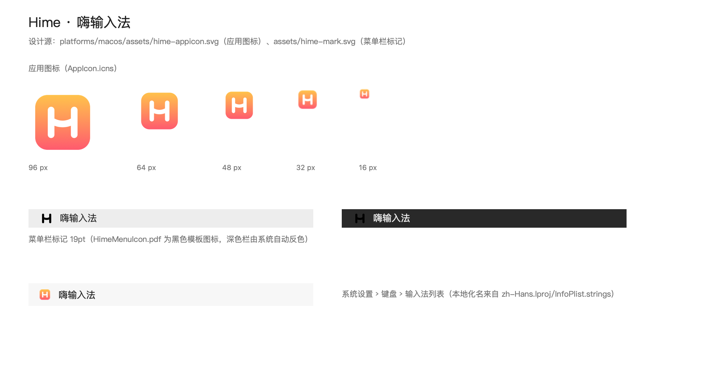

# macOS InputMethodKit (IMK) 宿主层规格书

## 1. 目录结构 (`platforms/macos/`)
- `Info.plist`：macOS 输入法配置清单
- `main.swift`：程序入口，初始化 `hime_init` 并启动 `IMKServer`
- `HimeInputController.swift`：继承自 `IMKInputController`，对接 `hime-ffi`
- `assets/hime-appicon.svg`、`assets/hime-mark.svg`：图标设计源（SVG，矢量），见 §4
- `resources/zh-Hans.lproj/InfoPlist.strings`、`resources/en.lproj/InfoPlist.strings`：显示名本地化文案，见 §4
- `tools/make-icons.swift`：把 SVG 渲染成 `AppIcon.iconset` 与 `HimeMenuIcon.pdf` 的构建期工具，仅依赖 AppKit/Quartz
- `build.sh`：一键编译 Rust 静态库、调用 `swiftc` 编译 Swift 代码、生成图标与本地化资源、组装 `Hime.app` 并安装到 `~/Library/Input Methods/` 的脚本。

## 2. `Info.plist` 关键配置要求
- `CFBundleIdentifier`: `com.hime.inputmethod.Hime`
- `CFBundleName`: `Hime`
- `InputMethodConnectionName`: `Hime_1_Connection`
- `InputMethodServerControllerClass`: `HimeInputController`
- `LSBackgroundOnly`: `true`
- `tsInputMethodIconFileKey` / `tsInputModeMenuIconFileKey` / `tsInputModeAlternateMenuIconFileKey`: 指向 `HimeMenuIcon.pdf`，`CFBundleIconFile` 指向 `AppIcon`，见 §4

## 3. Swift 关键实现细节
1. **命名固定**：在 `HimeInputController.swift` 中，使用 `@objc(HimeInputController)` 注解类，确保 Objective-C 运行时找得到类名（避免 Swift 模块名前缀导致 IMK 找不到 Controller）。
2. **全局候选窗**：在 `main.swift` 中创建全局 `var sharedCandidates: IMKCandidates!`，初始化为 `IMKCandidates(server: server, panelType: kIMKSingleRowSteppingCandidatePanel)`。
3. **生命周期**：
   - `init!(server: Data!, delegate: Any!, client inputClient: Any!)` 中调用 `hime_create_session()`。
   - `deinit` 中调用 `hime_destroy_session(sessionId)`。
4. **按键拦截与转换**：
   - 重写 `override func handle(_ event: NSEvent!, client sender: Any!) -> Bool`。
   - 仅处理 `event.type == .keyDown`。
   - 若包含 `.command` 或 `.control` 修饰键，直接返回 `false`。
   - 将 `event.keyCode` / `event.characters` 映射为 `SPEC_MVP.md` 中定义的 ASCII 码（注意 macOS Virtual KeyCode：`36`->Enter(13), `49`->Space(32), `51`->Backspace(8), `53`->Escape(27)）。
5. **渲染响应 (`EngineResponse`)**：
   - 调用 `hime_process_key` 解析 JSON。
   - 若 `commit_text` 非空，调用 `client.insertText(commitText, replacementRange: NSRange(location: NSNotFound, length: NSNotFound))`。
   - 更新内嵌预览 `preedit`：调用 `client.setMarkedText(preedit, selectionRange: NSRange(location: preedit.count, length: 0), replacementRange: NSRange(location: NSNotFound, length: NSNotFound))`。
   - 重写 `override func candidates(_ sender: Any!) -> [Any]!` 返回当前的候选词字符串数组（格式如 `"工"`），并在 `handle` 中根据 `candidates.isEmpty` 调用 `sharedCandidates.hide()` 或 `sharedCandidates.update()` + `sharedCandidates.show(kIMKLocateCandidatesBelowHint)`。候选词文字必须互不重复（由 `hime-core` 的 `DedupFilter` 在 `Pipeline` 末端保证）：`IMKCandidates` 以候选字符串本身作为候选标识，重复文字会被折叠成一格而编号仍按数组位置计数，出现 1、4 空号只剩 2/3/5 的错乱显示。
6. **候选面板不抢状态**（`IMKCandidates` 的两个默认行为都会绕过 Rust 会话，必须关掉）：
   - 面板创建后立即 `sharedCandidates.setAttributes([IMKCandidatesSendServerKeyEventFirst: NSNumber(value: true)])`。默认值为 NO，即按键先给候选面板；面板的选择键默认就是数字 1-9，会自行完成选择，导致 `SPEC_MVP.md` §3 规定由引擎处理的 `1`-`5` 落到面板上，引擎仍保留旧编码继续组字。设为 YES 后按键先经 Controller（即 `hime_process_key`），未被消费的按键仍会回落到面板。
   - 重写 `override func candidateSelected(_ candidateString: NSAttributedString!)`（`IMKInputController` 基类已有实现，会自行把面板字符串上屏），在 `currentCandidates` 中按文字找到索引，向引擎回灌对应数字键 `49 + index`，由引擎完成上屏与状态清空；找不到对应候选时只记 `NSLog` 并保持组字状态。
7. **词库路径**：`build.sh` 需将 `data/xingma_sample.tsv` 拷贝到 `Hime.app/Contents/Resources/` 下，Swift 启动时通过 `Bundle.main.path(forResource: "xingma_sample", ofType: "tsv")` 获取路径传给 `hime_init`。

## 4. 命名与图标

**中文名**：内部标识保持英文 `Hime`（`CFBundleIdentifier`、可执行名、`InputMethodConnectionName` 都不变），对用户只暴露中文名“嗨输入法”。显示名由本地化解析得到，`Info.plist` 里的 `CFBundleName` 只是 `CFBundleDevelopmentRegion` 的兜底值：

- `Contents/Resources/zh-Hans.lproj/InfoPlist.strings`：`CFBundleName`、`CFBundleDisplayName` 与两个 TIS 输入源 ID（`com.hime.inputmethod.Hime`、`com.hime.inputmethod.Hime.Hans`）都映射为 `嗨输入法`；`en.lproj` 用同样四个键映射为 `Hime`。缺这些条目时，系统设置的输入法列表会直接把输入源 ID 字符串当作名称显示。
- `Info.plist` 需要 `LSHasLocalizedDisplayName` 为 `true`，LaunchServices 才会改用本地化名称。
- 输入模式 dict 里 `TISIconLabels.Primary` 设为 `嗨`，供系统在需要文字标签时（无障碍、图标不可用）使用；列表与输入法菜单里的完整名称仍来自上面的 strings。

**图标**：标记是字母 H：两根胶囊竖笔之间用一条下凹的微笑弧线作横笔，呼应“嗨”的问候语气。100 网格上竖笔宽 17、圆角 8.5，保证 16px 下仍是实心笔画。

- `assets/hime-appicon.svg`：应用图标设计源，按 macOS 图标网格绘制（1024 画布、824×824 圆角容器、圆角 185），琥珀到珊瑚的竖向渐变底加白色标记。`build.sh` 由它生成 `AppIcon.icns`，经 `CFBundleIconFile` 显示在系统设置的输入法列表里。
- `assets/hime-mark.svg`：纯黑剪影标记。`build.sh` 由它生成 19pt 页面的 `HimeMenuIcon.pdf`，由 `tsInputMethodIconFileKey` 与 `tsInputModeMenuIconFileKey`、`tsInputModeAlternateMenuIconFileKey` 引用；黑色单色矢量会被系统当作模板图标，深色菜单栏自动反色。
- `tools/make-icons.swift`：`xcrun swift tools/make-icons.swift <assets-dir> <out-dir>`，用 `NSImage` 解码 SVG、`CGContext` 输出 PNG 与 PDF（PDF 内保留矢量路径），再由 `iconutil -c icns` 打包，不引入外部光栅化依赖。两份 SVG 里的标记几何必须保持一致。

**生效与验证**：`build.sh --install` 在签名后执行 `lsregister -f` 刷新 LaunchServices 的名称与图标缓存，再调用 `TISRegisterInputSource`。验证读取 TIS 属性即可：`kTISPropertyLocalizedName` 应为 `嗨输入法`，`kTISPropertyIconImageURL` 应指向包内的 `HimeMenuIcon.pdf`。
